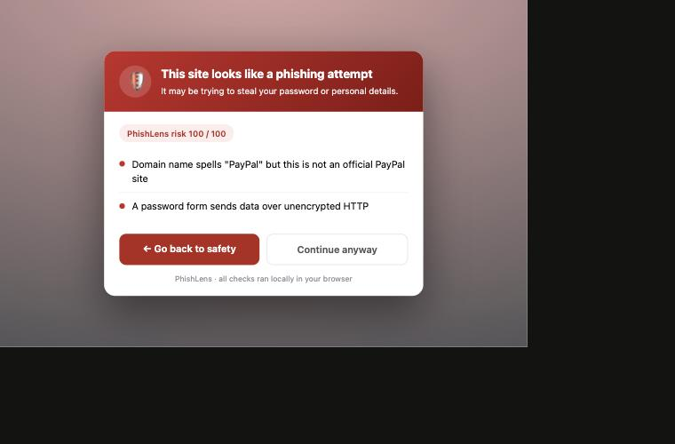
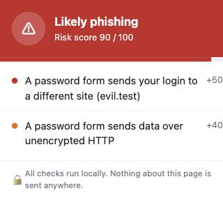

# PhishLens

Local-first phishing detection for Chromium browsers.


A browser extension that flags likely phishing pages while you browse. Every check runs on your machine. The code makes no network calls, and there's a test that keeps it that way.

**What it does:** looks at the page URL, the redirect hops that led there, and any password form, then scores the page on local rules and warns you if it looks like a credential-stealing attempt.

**What it doesn't do:** it doesn't promise a site is safe, it doesn't block navigation (the banner warns, you decide), and it doesn't replace your browser's own protection. It's a learning project, not a security product.

**Try it in two minutes:** load the `extension/` folder at `brave://extensions` (Developer mode on, then Load unpacked), then open `test-pages/fake-login.html` for a warning and `test-pages/safe-login.html` for a clean page. Run `npm test` for the rule tests.

I built this to learn how phishing detection and browser extensions actually work. The detection rules sit in one small module with no browser code in it, so the rules I ship are the same ones the tests and the accuracy script run.

## How it fits together

Three small parts hand work to each other:

- `extension/content.js` runs on the page and reads its login forms.
- `extension/background.js` adds the redirect history and asks the rules for a verdict, then sets the badge and fires the banner.
- `extension/core/detect.js` is the rules themselves: plain functions, no browser code, so the tests and the accuracy script run exactly what ships.

## What it looks like

When a page looks dangerous, a full-screen warning appears over it with the reasons and a way back to safety (it warns, it doesn't block, "Continue anyway" proceeds):



Click the toolbar icon for the page's risk score and the signals that fired:



## What it checks

| Signal | Example | Weight |
|---|---|---|
| Domain spells a brand but isn't the brand | `paypa1.com`, `g00gle-mail.com` | high |
| Brand name on an unrelated domain | `paypal.com.secure-login.xyz` | high |
| Password form posts to a different domain | the login page sends your password somewhere else | high |
| Password form over plain HTTP | a login with no HTTPS | high |
| Redirect chain across several domains, or through a shortener | `bit.ly`, then two more hops, then `paypa1.com` | medium |
| Homograph domain: punycode decoded, Latin mixed with look-alike Cyrillic/Greek letters | `xn--pypal-4ve.com` decodes to `pаypal` | medium |
| Raw IP host, `@` in the URL, lots of subdomains, very long URL | `http://192.168.0.5/login` | low |

Each signal adds points to a score from 0 to 100. Below 30 it stays quiet. From 30 to 59 it puts a caution badge on the icon. At 60 or more it shows the banner.

If it flags a site you know is fine, the popup has a **Trust this site** button. That domain goes on an allowlist (stored in `chrome.storage.sync`, so it follows you across your signed-in browsers) and is never flagged again.

## Layout

```
extension/          the extension itself (load this folder in the browser)
  core/detect.js    the detection rules, plain functions, no browser code
  core/brands.js    brands and their real domains
  background.js     tracks redirects, runs the rules, sets the badge
  content.js        reads login forms, draws the warning banner
  popup.js/.html    the toolbar popup
tests/              tests for the rules (node --test)
tools/evaluate.js   accuracy check over URL lists
data/               sample URL lists for the check
test-pages/         local pages to try it on safely
```

## Running the tests

```bash
npm test
```

## Checking the accuracy

```bash
npm run eval
```

Right now, against the sample lists (20 phishing URLs, 35 legit URLs including ordinary non-login sites):

```
Detection rate:  18/20  (90.0%)
False positives: 0/35   (0.0%)
```

Those lists are synthetic. I wrote them by hand in November 2026 to exercise the rules, so treat the numbers as a demo of the method, not a prediction of real-world performance. For real numbers, swap in a real feed (an OpenPhish or PhishTank export) and a list of common legit domains, and note the date you collected it:

```bash
node tools/evaluate.js data/real-phishing.txt data/real-legit.txt
```

## Loading it in Brave or Chrome

1. Open `brave://extensions` or `chrome://extensions`.
2. Turn on Developer mode (top right).
3. Click Load unpacked and pick the `extension/` folder.
4. Open `test-pages/fake-login.html`. You should get a red banner.
5. Open `test-pages/safe-login.html`. Nothing should happen.

## What it doesn't do yet

- The accuracy numbers come from the synthetic samples, not a live feed. The approach is real, the data is a placeholder until I wire a feed in.
- The accuracy script only sees the URL. The redirect and form checks need a live page, so they help in the browser but don't count in `npm run eval`.
- It still misses two cases the sample run shows: a brand name sitting only in the URL path (`192.168.0.5/paypal/login`), and short brand names like `dhl` that I skip on purpose so they don't match inside ordinary words. Punycode lookalikes (`xn--...`) used to be a miss; they're now decoded and caught.
- A brand word in the path of a real brand site (say `amazon.com/paypal-vs-stripe`) is intentionally not flagged, to avoid false positives. There's a test for that.
- Domain parsing uses a short built-in suffix list instead of the full Public Suffix List, so a few uncommon multi-part TLDs get grouped wrong.
- The weights are hand-set, not trained. A small trained model is the next thing I want to try.

## Requirements and support

- Works in Chromium browsers: Brave, Chrome, Edge. Not Firefox (it uses Manifest V3 service workers).
- Running the tests needs Node 18 or newer. The extension itself has no dependencies.

## Permissions, and why

- `webNavigation`, `webRequest` — to see redirect hops before a page loads.
- `storage` — to keep the current page's verdict in `chrome.storage.session` (so the popup still works after the worker sleeps) and your trusted-site allowlist in `chrome.storage.sync`.
- host access is limited to `http://*/*` and `https://*/*`, and the content script runs only on those. No access to `file://` pages or browser internals.

## Privacy

Everything runs in the browser against local data. No `fetch`, no `XMLHttpRequest`, no server.

## What I built, learned, and would change

**Built.** A Chromium extension that scores pages for phishing on local rules: brand look-alikes, brand names on unrelated domains, cross-domain and plain-HTTP password forms, suspicious redirect chains, and URL-shape red flags. The rules live in one module with no browser code, so the tests and the accuracy script run exactly what ships. The verdict is kept in `chrome.storage.session` so the popup survives the service worker going to sleep, which is the part of Manifest V3 that trips people up.

**Learned.** How Manifest V3 pulls an extension apart into a content script, a background worker, and a popup, and why that worker can restart under you. How phishing actually hides: character swaps like `paypa1`, a brand name buried in a subdomain, the `user@host` trick. And that the honest part of a detector is the false-positive rate, which is why the legit list is as long as the phishing one.

**Would change next.** Swap the hand-written weights for a small trained model and compare the two honestly. Run it against a real phishing feed for numbers that mean something. Pull in the full Public Suffix List if the short one starts costing accuracy.

This is a local-first phishing-detection prototype with explainable rules and browser-level checks. It is a learning project, not a production anti-phishing engine, and it doesn't block navigation, it warns and leaves the choice to you.
